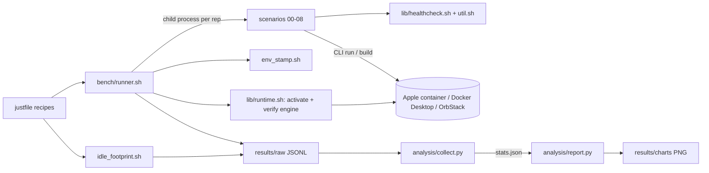

# apple-container-vs-docker

A **reproducible, real-data benchmark** comparing three ways to run Linux containers
on an Apple Silicon Mac:

| Runtime | CLI | Model | Compose | DevContainers |
|---------|-----|-------|---------|---------------|
| **Apple `container`** v1.0 | `container` | one lightweight VM **per container** | ❌ (3rd-party bridges only) | ⚠️ incomplete |
| **Docker Desktop** | `docker` | one shared VM | ✅ | ✅ |
| **OrbStack** | `docker` | one shared lightweight VM | ✅ | ✅ |

This repo backs the ASTGL tutorial *"Apple Container vs Docker: when to use which on
Apple Silicon."* **Every claim in the article traces to a number or a logged failure
in `results/`.** No vibes.

> ⚠️ OrbStack and Docker Desktop both expose the `docker` CLI and **cannot run at the
> same time**. The harness switches the active engine between runs and stamps which one
> served each result.

## Test environment (the reference run)

Captured automatically into every result file by `bench/env_stamp.sh`. The reference
machine for the published article:

- **macOS 26.5.1 (Tahoe, build 25F80)** — full container networking (matters: macOS 15
  cannot do container-to-container networking with Apple `container`)
- **Apple M3 Ultra, 256 GB RAM** (Mac Studio)
- Docker 29.3.1 / Compose v5.1.0 · OrbStack 2.2.1 · Apple `container` 1.0.0

## Methodology — the fairness controls

These are the controls that separate a real benchmark from a screenshot of one run:

1. **Images pinned by digest** (`images/manifests.lock`) — so all runtimes pull identical
   OCI bytes. Not yet in effect: every digest in the lock is still `TODO` and the
   scenarios and image Dockerfiles reference tags (only some are marked `TODO`).
2. **Versions + macOS build + chip + thermal state stamped into every result** for
   reproducibility.
3. **Cold vs warm reported separately** — never blended. The warmup rep is discarded;
   scenario 6 records `build_nocache_ms` and `build_cached_ms` as separate metrics.
4. **N ≥ 10 reps; warmup run discarded; report median + p95 + stdev** — never a single
   cherry-picked number.
5. **Subprocess isolation per run** — clean child process per measurement, state torn
   down between reps (lesson from the DiffusionGemma harness: in-process state
   accumulation silently corrupts results).
6. **Resource-model asymmetry documented, not hidden** — Docker Desktop & OrbStack run a
   *shared* VM with a fixed CPU/RAM budget; Apple `container` runs a VM *per container*.
   The asymmetry is called out in the write-up. `bench/env_stamp.sh` records host and tool
   versions, not the VM's allocated CPU/RAM. TODO(james): capture each engine's allocated
   resources in the stamp.

## Scenarios

| # | Scenario | Isolates |
|---|----------|----------|
| 0 | `alpine` true | VM spin-up + teardown overhead (baseline) |
| 1 | `nginx` → first HTTP 200 | time-to-usable, simple service |
| 2 | `postgres:16` → TCP accept | time-to-usable + steady RAM, stateful service |
| 3 | `sysbench` CPU | per-VM CPU overhead |
| 4 | `fio` on a bind-mounted dir | Mac file-sync I/O (the dev-loop pain point) |
| 5 | `iperf3` ctr↔ctr (client → server on one network) | network throughput + macOS 26 multi-net path |
| 6 | multi-stage Go build | build speed + cache behavior |
| 7 | Postgres + Redis on a shared network | the real dev workload + the DX-tax (command count) |
| 8 | density ramp | how many containers before failure (256 GB headroom) |

Plus an **idle-footprint** measurement (`just idle`: helper-process RSS with nothing
running) and the behavioral gaps logged as they are hit in
[`docs/findings.md`](docs/findings.md).

## Quick start

```bash
just doctor            # verify which runtimes are installed + active
just build-images      # build the benchbox image on every runtime (needed by scenarios 3-5)
just bench-all         # run every scenario across every available runtime → results/raw/
just bench docker-desktop 01_nginx 10   # one scenario on one runtime (reps defaults to 10)
just idle              # idle helper footprint per runtime → results/raw/idle_footprint__*.jsonl
just setup-analysis    # one-time: create .venv and install matplotlib
just report            # aggregate JSONL → results/stats.json → PNG charts in results/charts/
just clean             # wipe results (keeps the .gitkeep dirs)
```

Runtime names are `apple-container`, `docker-desktop`, `orbstack`. A runtime that is
missing or not the active engine is logged as `skipped` in the JSONL, not silently dropped.

Tests (no container runtime needed; `pytest` is not in `analysis/requirements.txt`):

```bash
python3 -m pytest tests/
```

Charts are emitted as **PNG** (Substack renders markdown tables badly — ASTGL house rule).

## Layout



<!-- archify:begin -->
### System map


Interactive: [`docs/diagrams/apple-container-vs-docker.architecture.html`](docs/diagrams/apple-container-vs-docker.architecture.html)
— search, trace routes, compare roles. Source of truth is the typed IR
[`apple-container-vs-docker.architecture.json`](docs/diagrams/apple-container-vs-docker.architecture.json); edit that, never the HTML.
<!-- archify:end -->

```
justfile               task runner (doctor, build-images, bench, bench-all, idle, report, clean)
bench/
  runner.sh            (runtime, scenario, reps) → JSONL, subprocess-isolated
  env_stamp.sh         machine/version/thermal stamp
  idle_footprint.sh    helper-process RSS at idle, per runtime
  lib/runtime.sh       adapter: maps runtime → CLI + "ensure engine active"
  lib/healthcheck.sh   poll-to-ready helpers (TCP / HTTP 200) + now_ms
  lib/util.sh          free_port, container_ip, service_endpoint, mem_mb
  scenarios/           one script per workload 0–8
  images/              benchbox (sysbench/fio/iperf3) + sampleapp (Go, compose file)
images/manifests.lock  pinned image digests (digests still TODO)
analysis/collect.py    JSONL → results/stats.json (median/p95/stdev, warmup dropped)
analysis/report.py     stats → one PNG bar chart per scenario × metric
tests/                 pytest unit tests for parsing, report helpers, shell utils
docs/findings.md       behavioral facts + 1-rep smoke numbers (not the article's data)
docs/diagrams/         Archify system map (json = source, html/svg = rendered)
results/{raw,charts}/  raw JSONL (git-ignored) and PNG charts
article/               git-ignored draft for Substack
```

## License

MIT © James Cruce ([Jmeg8r](https://github.com/Jmeg8r))
